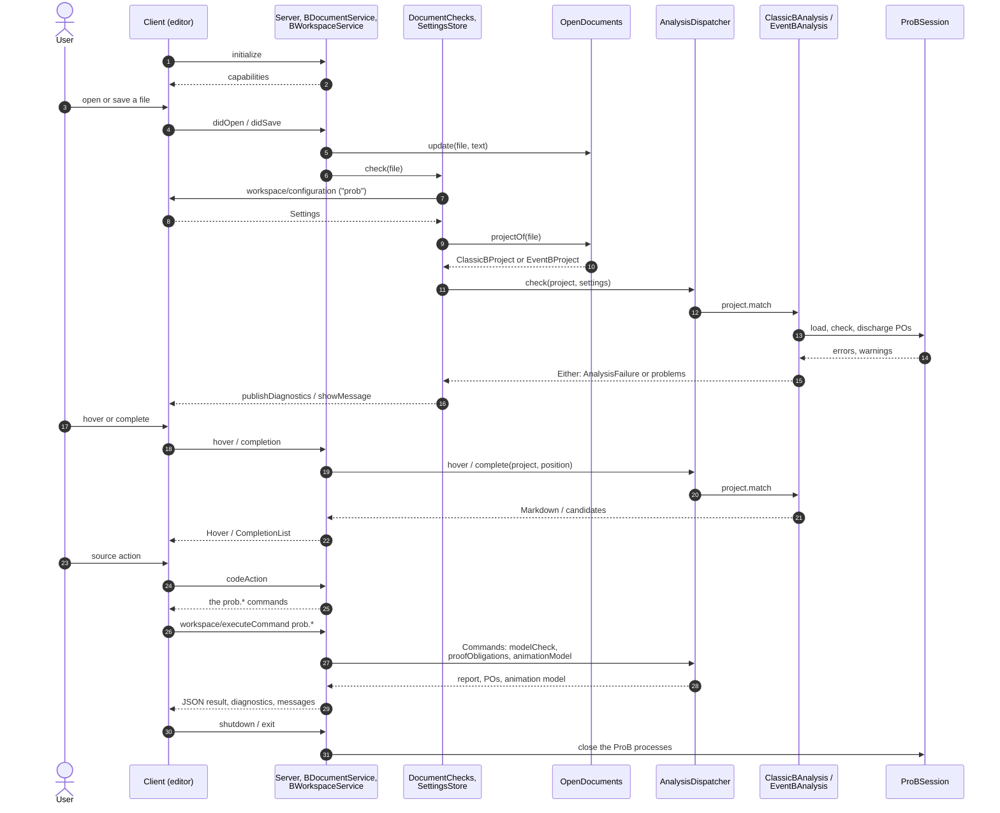
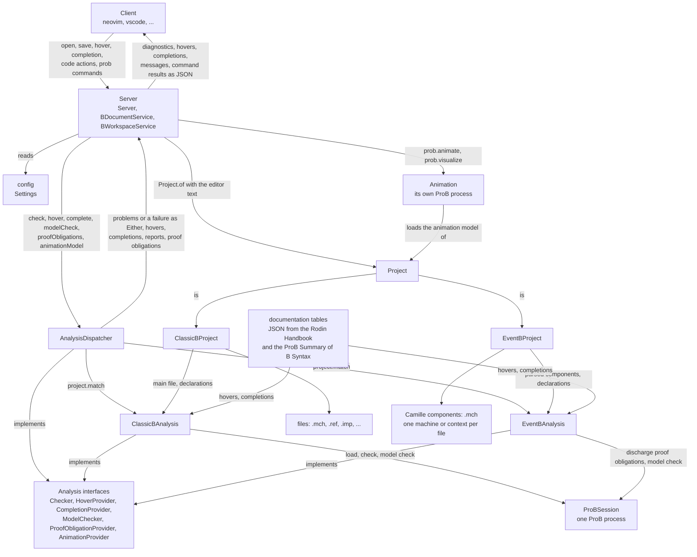
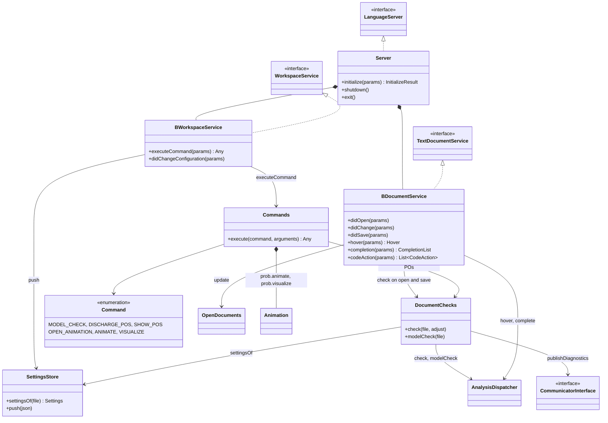
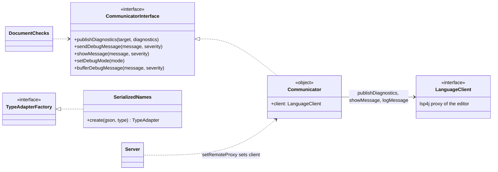
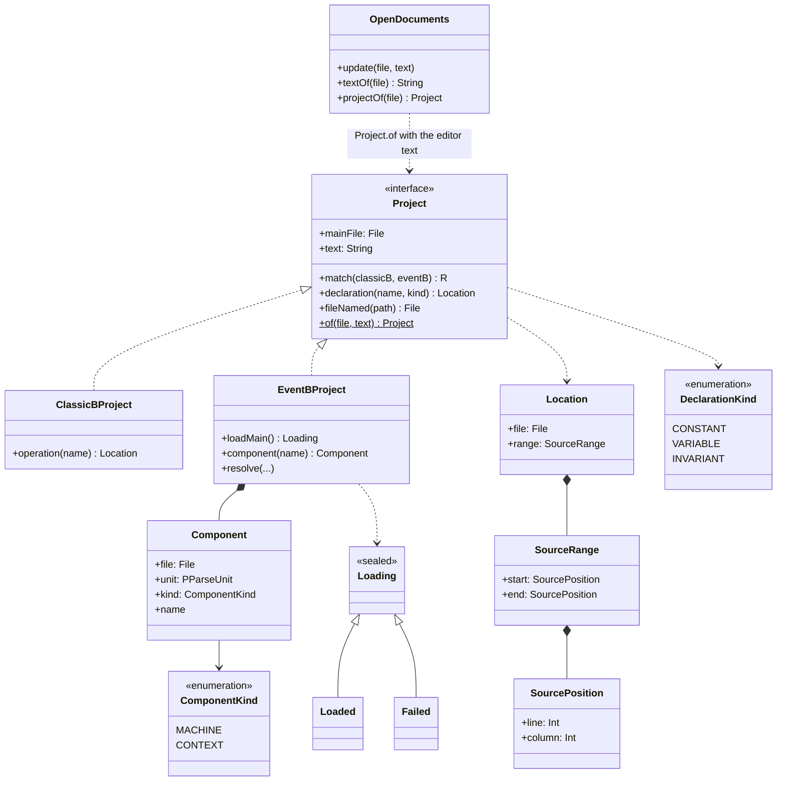
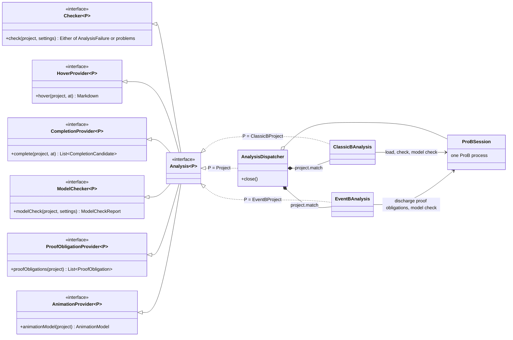
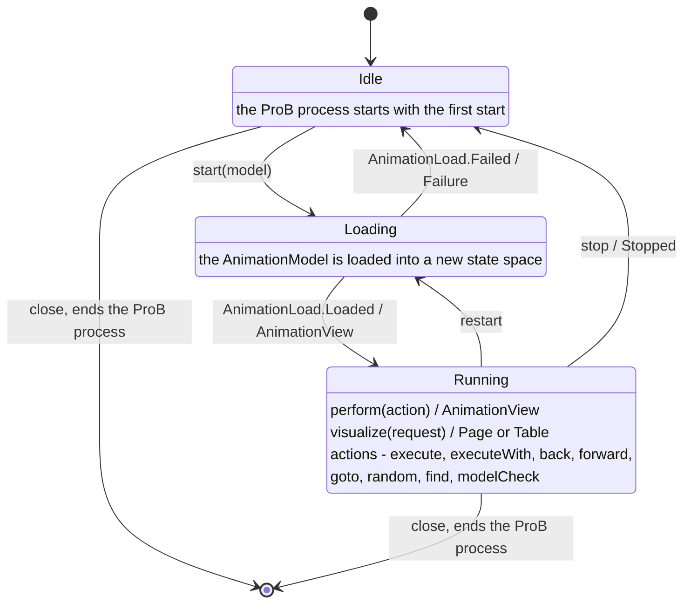
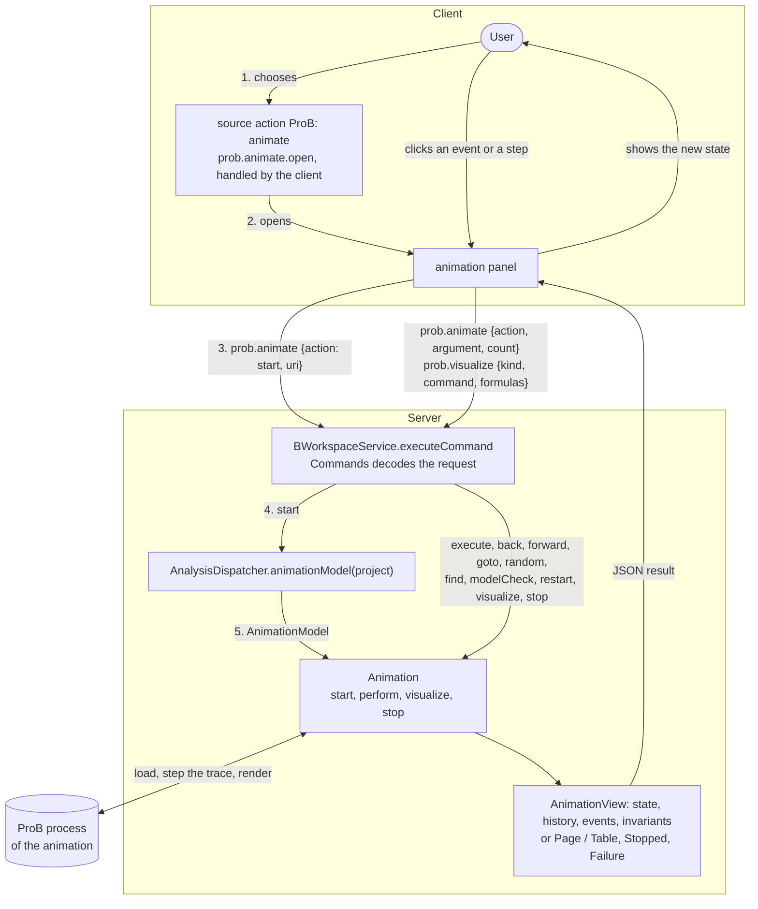

# Module b-language-server

Implement the Language Server Protocol for classical B and Event-B using Kotlin, lsp4j and ProB, whose probcli
ships with the ProB Java Kernel.

Clients (neovim, VS Code, ...) talk to the server over stdio (`--stdio`) or a TCP socket. The server turns their
requests into calls of the analysis of the model's kind, which runs in a shared ProB process. Animations run in a
ProB process of their own.

The source, issues and releases are on GitHub: [quoteme/b-language-server](https://github.com/quoteme/b-language-server).

## Clients

| Client | Editor | Project page |
| ------ | ------ | ------------ |
|  b.nvim | Neovim | [github.com/Quoteme/b.nvim](https://github.com/Quoteme/b.nvim) |
|  b.vscode | Visual Studio Code | [github.com/Quoteme/b.vscode](https://github.com/Quoteme/b.vscode) |

## How a request flows through the server

## Components

# Package b.language.server.server

The language server: it receives the client's LSP requests, asks the analysis, and answers the client.

# Package b.language.server.client

How the server talks to the client on its own: diagnostics, messages and debug output.

# Package b.language.server.project

A B model: the file the user works on, its text in the editor, and the files it depends on.

# Package b.language.server.analysis

What the server asks of the analysis of one kind of project, and the dispatcher that picks the analysis by the
project's kind.

# Package b.language.server.analysis.classicB

The analysis of classical B, which ProB does.

# Package b.language.server.analysis.eventB

The analysis of Event-B in Camille notation: Rodin's static checker, and proof obligations discharged by ProB.

# Package b.language.server.analysis.documentation

The documentation of keywords and operators shown in hovers and completions, from the Rodin Handbook and ProB's
Summary of B Syntax.

# Package b.language.server.analysis.prob

The connection to ProB: one process per session, its preferences, and the problems it reports.

# Package b.language.server.analysis.prob.animation

The animation of a classical B or Event-B machine, in a ProB process of its own so that checking files while
animating does not disturb it.

## Lifecycle of an animation

## The client and the animation, back and forth

